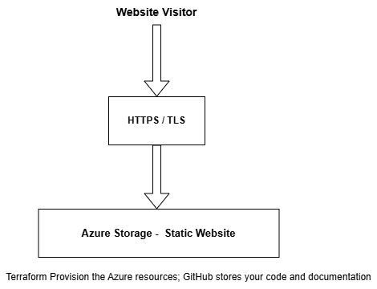

# Azure Retail Platform

## Project Overview

This project demonstrates how to host a simple retail product catalogue on Microsoft Azure using Terraform.

The website displays products to visitors over the internet. It uses Azure Storage static website hosting, so it does not require a web server to run application code.

## Business Scenario

A small retailer wants a simple online catalogue where customers can browse products. The business needs a solution that is affordable, easy to maintain, and repeatable to deploy.

The current project provides product browsing only. Ordering, payments, and delivery tracking are not implemented.

## Architecture

The diagram below shows how the retail catalogue is hosted on Azure.

